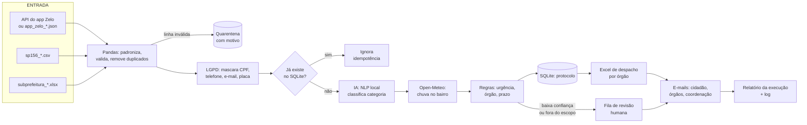

# Robô Zelo: triagem e despacho automático de zeladoria urbana (RPA + IA)

Global Solution 2026.2 da FIAP (CitizenTech), disciplina **AI for Robotic Process Automation**.

Este robô é a parte de back-office do **Zelo**, a mesma solução das outras disciplinas da GS
(app de relatos em [gs-front](https://github.com/gabrielpalmeiraa/gs-front)). O app atende o cidadão;
o robô faz o trabalho repetitivo que hoje cai no colo dos servidores da Prefeitura.

**Integrantes**

| Nome | RM |
|---|---|
| Gabriel Palmeira | 563522 |
| Mayara Mota | 563887 |

---

## 1. O problema

Quem mais sofre com a falta de manutenção das ruas é quem anda a pé: idosos, pessoas com
deficiência, usuários de transporte público e moradores da periferia. Só no primeiro semestre de
2026, São Paulo recebeu quase 52 mil pedidos de tapa-buraco, cerca de 287 por dia
([BNews](https://www.bnewssaopaulo.com.br/noticias/politica/mesmo-apos-recapeamento-sp-registra-quase-52-mil-pedidos-de-tapa-buraco.html)),
e "buraco e pavimentação" já liderou os assuntos da Ouvidoria Geral do Município
([relatório OGM](https://www.prefeitura.sp.gov.br/cidade/secretarias/upload/controladoria_geral/Rel_Triml_OGM-3o_trim_2023_publicacao_05_12_2023.pdf)).

Os relatos chegam por canais diferentes, cada um num formato: a planilha exportada do SP156, a
planilha que a subprefeitura preenche à mão e o app Zelo. Alguém precisa juntar tudo, descobrir o
que é cada pedido, decidir o que é urgente, separar por órgão responsável, mandar para cada equipe
e avisar o cidadão. Feito à mão, isso atrasa justamente os casos de risco (um fio caído pode
esperar na mesma fila que um pedido de poda).

**Público atendido:** o cidadão que fez o relato (recebe protocolo e prazo de referência) e o
servidor da Prefeitura (recebe a fila já triada, priorizada e sem dados pessoais).

## 2. O que o robô faz



Uma execução, sem intervenção:

1. Busca os relatos novos do app Zelo pela API (`GET /api/v1/gestor/relatos`). Se a API não estiver
   configurada ou não responder, lê o arquivo exportado do app.
2. Lê o CSV do SP156 e o Excel da subprefeitura, padroniza tudo num único formato e valida linha
   a linha. Bairro desconhecido, descrição vazia ou data impossível vão para a **quarentena** com o
   motivo; o resto segue.
3. Remove CPF, telefone, e-mail e placa do texto. Nada com dado pessoal segue adiante.
4. Descarta o que já foi processado em execuções anteriores (chave única no banco).
5. Classifica o tipo de problema com um modelo de NLP local e calcula a urgência com regras
   explicáveis, cruzando com a previsão de chuva do bairro.
6. Grava tudo no SQLite, gera o protocolo e monta uma planilha de despacho por órgão, ordenada da
   mais urgente para a menos urgente.
7. Envia os e-mails: confirmação para o cidadão (só se ele autorizou), planilha para cada órgão
   (com "[CRÍTICO]" no assunto quando for o caso) e relatório para a coordenação.
8. O que o robô não resolve com segurança vai para `revisao_humana.xlsx`, com colunas para o
   servidor preencher a decisão.

## 3. Quadro de temas

O robô usa **4 temas da disciplina**, mais a parte de IA. Cada um tem função real no fluxo: se
qualquer um for removido, o robô deixa de entregar alguma coisa.

| Tema | Onde está no fluxo | O que resolve | Por que escolhemos |
|---|---|---|---|
| **Tratamento de arquivos e dados (Pandas)** | `zelo_robo/ingestao.py`: lê CSV (`;`, datas dd/mm/aaaa, caixa alta), Excel (`openpyxl`) e JSON; renomeia colunas para um esquema único; normaliza bairros sem acento; valida; remove duplicados; gera planilhas de saída em `relatorio.py` | Junta 3 canais com formatos diferentes num único fluxo e separa o dado ruim sem parar o robô | É o problema real de quem recebe pedidos de vários lugares: o dado chega "sujo" e em formatos que não conversam |
| **Integração com APIs** | `zelo_robo/integracoes.py`: Open-Meteo (chuva prevista por bairro) e API REST do app Zelo (relatos novos, autenticada por token no cabeçalho) | Traz contexto que muda a decisão (35 mm de chuva tornam um bueiro entupido mais urgente) e integra o robô ao app sem copiar arquivo à mão | Conecta o robô à solução única da GS e a dados abertos. A Open-Meteo é gratuita e não exige chave |
| **Banco de dados SQL (SQLite)** | `zelo_robo/banco.py`: tabelas `solicitacoes`, `envios`, `contatos`, `quarentena` e `execucoes`, com `UNIQUE` e `CHECK` | Gera protocolo, garante **idempotência** (rodar 2 vezes não duplica nada nem reenvia e-mail), guarda a fila de reenvio e o histórico de execuções | Um robô que roda todo dia precisa de memória. O SQLite não exige servidor e roda igual em qualquer máquina |
| **E-mail automatizado** | `zelo_robo/email_envio.py`: `smtplib` com STARTTLS, anexos Excel/Markdown, retry e fila de pendentes; modo "arquivo" gera `.eml` | Entrega o resultado para quem age: o órgão recebe a planilha, o cidadão recebe o protocolo, a coordenação recebe o relatório | E-mail é o canal que qualquer órgão público já usa; não exige que a equipe instale nada |
| IA (base para os temas) | `zelo_robo/classificador.py` + `zelo_robo/regras.py` | Classifica o tipo de problema (TF-IDF de palavras e de caracteres + Regressão Logística) e decide urgência com regras auditáveis | Modelo local, gratuito e sem LLM: nenhum texto de cidadão sai da máquina. A probabilidade do modelo decide quando chamar um humano |

**Como os temas se combinam:** o Pandas limpa o que entra; a IA decide; a API traz contexto para
a decisão; o banco garante que nada é feito duas vezes e guarda o que falhou; o e-mail entrega o
resultado e é reenviado pelo banco se o servidor cair. A planilha que o Pandas gera é o anexo que
o e-mail entrega.

## 4. Como executar

Requisitos: Python 3.10 ou mais novo. Testado com Python 3.13 no Linux; os comandos abaixo são
para macOS/Linux (no Windows, troque `source .venv/bin/activate` por `.venv\Scripts\activate`).

```bash
git clone https://github.com/gabrielpalmeiraa/gs-rpa.git
cd gs-rpa
python3 -m venv .venv
source .venv/bin/activate
pip install -r requirements.txt
cp .env.example .env          # funciona sem editar nada (e-mail em modo "arquivo")

python main.py --resetar --demo
```

O `--demo` cria um lote de exemplo em `entrada/` (com erros de propósito) e o robô processa tudo.
No fim aparece um resumo e os resultados ficam em `saida/<data-hora>/`:

| Arquivo | Conteúdo |
|---|---|
| `relatorio_execucao.md` / `.json` | números da execução, integrações, quarentena, revisão, e-mails, alertas |
| `despachos/despacho_<órgão>.xlsx` | lista de cada órgão, ordenada por urgência, com a justificativa de cada uma |
| `revisao_humana.xlsx` | o que o robô não decidiu sozinho, com colunas para o servidor preencher |
| `quarentena.csv` | linhas rejeitadas e o motivo |
| `outbox/*.eml` | todos os e-mails gerados (abrem no Mail/Outlook com os anexos) |
| `logs/robo.log` | log completo de todas as execuções, sem dados pessoais |

Um exemplo de cada saída está em [`docs/exemplo_saida/`](docs/exemplo_saida/).

**Outros comandos**

```bash
python main.py                           # processa o que estiver em entrada/ (uso diário)
python main.py --demo                    # roda de novo o mesmo lote: mostra a idempotência (0 novos)
python main.py --resetar --demo --simular-falha api smtp arquivo   # demonstra o tratamento de falhas
python -m scripts.validar                # gera docs/evidencias/resultado_validacao.md
python -m pytest -q                      # 17 testes automatizados
python -m scripts.gerar_dados            # recria a base de treino e o lote de demonstração
python -m scripts.treinar_modelo         # retreina o modelo (o robô também treina sozinho se ele faltar)
```

### Configuração das chaves (`.env`)

Nenhuma senha ou token fica no código: tudo é lido do `.env`, que está no `.gitignore`. O robô
roda sem nenhuma chave (e-mail vira arquivo `.eml`, API do app vira arquivo JSON).

| Variável | Para que serve | Obrigatória? |
|---|---|---|
| `EMAIL_MODO` | `arquivo` (padrão) ou `smtp` | não |
| `SMTP_HOST`, `SMTP_PORTA`, `SMTP_USUARIO`, `SMTP_SENHA`, `SMTP_TLS` | servidor de envio | só no modo `smtp` |
| `ZELO_API_URL`, `ZELO_GESTOR_TOKEN` | API do app Zelo (ex.: `https://zelo-api-fxru.onrender.com` e o código de gestor) | não |
| `CLIMA_HABILITADO` | `0` desliga a consulta de chuva | não |

**Enviar e-mail de verdade (gratuito):**

- **Mailtrap** (recomendado para testes): crie uma conta grátis, abra *Email Testing > Inboxes* e
  copie host, porta, usuário e senha para o `.env` com `EMAIL_MODO=smtp`. Os e-mails aparecem na
  caixa do Mailtrap e não chegam a ninguém de verdade.
- **SMTP local, sem conta nenhuma:** em um terminal rode `python -m scripts.servidores_teste`; em
  outro rode `EMAIL_MODO=smtp SMTP_HOST=127.0.0.1 SMTP_PORTA=2525 SMTP_TLS=0 python main.py --resetar --demo`.
  O primeiro terminal mostra cada e-mail recebido.

## 5. Estrutura do repositório

```
main.py                      ponto de entrada (argumentos --demo, --resetar, --simular-falha)
zelo_robo/
  robo.py                    orquestra as etapas e isola as falhas
  ingestao.py                TEMA Pandas: leitura dos 3 canais, validação, quarentena
  classificador.py           IA: TF-IDF + Regressão Logística, carrega ou retreina
  regras.py                  urgência explicável, órgão, prazo, revisão humana
  integracoes.py             TEMA APIs: Open-Meteo e app Zelo, com timeout, retry e disjuntor
  banco.py                   TEMA SQL: esquema, idempotência, fila de e-mails
  email_envio.py             TEMA e-mail: SMTP ou .eml, retry, reenvio de pendentes
  relatorio.py               planilhas de despacho, revisão humana e relatório
  privacidade.py             mascaramento de dados pessoais (texto e log)
  referencia.py              bairros, subprefeituras, órgãos e prazos de referência
  config.py / log.py         configuração pelo .env e log em arquivo
scripts/                     geração de dados, treino, validação e servidores locais de teste
dados/treino/                880 relatos sintéticos rotulados (base de treino)
dados/teste/                 relatos escritos à mão: conjunto de desenvolvimento e conjunto de teste
docs/evidencias/             resultado da validação (gerado pelo scripts/validar.py)
docs/exemplo_saida/          exemplo real de relatório, planilhas e e-mails
tests/                       testes automatizados (pytest)
demo_colab.ipynb             a mesma execução em notebook, para rodar no Google Colab
```

## 6. Resiliência e segurança

| Falha previsível | O que o robô faz | Onde |
|---|---|---|
| Arquivo ausente num canal | avisa no log e no relatório e segue com os outros canais | `ingestao.ingerir` |
| Arquivo corrompido ou sem as colunas esperadas | rejeita só aquele arquivo, move para `entrada/com_erro/` e segue | `ingestao.ArquivoInvalido` |
| Linha com dado inválido | vai para a quarentena com o motivo (tabela, CSV e relatório) | `ingestao.validar` |
| Mesmo relato duas vezes no lote | descarta a cópia | `ingestao.validar` |
| Mesmo lote processado de novo | nada é duplicado e nenhum e-mail é reenviado (chave `UNIQUE`) | `banco.py`, `Carteiro.enviar` |
| API fora do ar ou lenta | timeout e até 3 tentativas, com espera crescente entre elas (1 s, depois 2 s); depois segue sem o dado. Erros 4xx não são repetidos. Depois de 2 bairros sem resposta o disjuntor para de tentar na execução | `integracoes.com_retry` |
| API do app Zelo indisponível | usa o arquivo exportado do app | `robo.executar` |
| Servidor de e-mail fora do ar | 3 tentativas; se falhar, guarda o `.eml` como pendente e reenvia na próxima execução | `email_envio.py` |
| Senha SMTP errada | não insiste (evita bloqueio da conta), registra e deixa pendente | `email_envio._entregar` |
| Arquivo do modelo de IA apagado ou corrompido | retreina automaticamente a partir da base | `Classificador.carregar_ou_treinar` |
| Erro inesperado em um relato | registra o erro e continua com os outros | `robo.executar` |
| Caso que o robô não deve decidir sozinho | fila de revisão humana (confiança abaixo de 55% ou fora do escopo) | `regras.decidir` |
| Caso **crítico** com baixa confiança | despachado mesmo assim **e** marcado para revisão: segurança antes da fila | `robo.executar` |

Toda execução gera relatório, registro na tabela `execucoes` e linhas no `logs/robo.log`. O
status final é `concluido`, `concluido_com_alertas` ou `falhou`.

## 7. Evidências de validação

Tudo abaixo é reproduzível com `python -m scripts.validar`, que gera
[`docs/evidencias/resultado_validacao.md`](docs/evidencias/resultado_validacao.md) com as tabelas
completas, a matriz de confusão, a lista de todos os erros e os trechos de log de cada cenário.

### 7.1 Como medimos

- **Base de treino:** 880 relatos sintéticos montados por combinação de trechos
  (`scripts/gerar_dados.py`, semente fixa).
- **Conjunto de desenvolvimento:** 72 relatos escritos à mão, usados para encontrar os erros da
  primeira versão das regras e corrigi-los.
- **Conjunto de teste:** 64 relatos novos (8 por categoria), escritos **depois** de o modelo e as
  regras estarem prontos. Nada foi ajustado olhando para ele. Nenhuma frase do teste aparece no
  treino. É o resultado que vale.

### 7.2 Resultado no conjunto de teste (64 relatos)

| O que foi medido | Resultado |
|---|---|
| Categoria certa (acurácia) | **87,5%** (56 de 64), F1 macro 0,871 |
| Enviados para revisão humana | 17 (27%) |
| Categoria certa entre os decididos sozinhos pelo robô | **91,5%** (43 de 47) |
| Erros de categoria que caíram na revisão humana | 4 de 8 |
| Urgência exata | 67,2% (43 de 64) |
| Urgência com até 1 nível de diferença | 95,3% (61 de 64) |
| Casos críticos reconhecidos como críticos | **4 de 8** |
| Falsos críticos | 0 |

No conjunto de desenvolvimento, as regras v1 acertavam 61,1% da urgência e só 5 de 8 críticos.
Depois da correção (v2), o mesmo conjunto passou para 90,3% e 8 de 8. A queda para 67,2% e 4 de 8
no conjunto novo mostra o quanto o ajuste ficou "colado" nos exemplos de desenvolvimento, e é
por isso que separamos os dois.

### 7.3 Análise dos erros

**Categoria.** Dos 8 erros, 4 foram pegos pela revisão humana (confiança baixa). Os outros 4:

- dois são relatos que realmente misturam categorias: "buraco perto da faixa de pedestre" virou
  sinalização com 86% de confiança, e "árvore bloqueando a placa de pare" virou sinalização. Uma
  palavra forte de outra categoria domina o texto, e o modelo fica confiante no lugar errado;
- "rua de terra virou lama" e "academia ao ar livre enferrujada" usam vocabulário que não existe
  na base de treino.

**Urgência.** Dos 21 erros, 11 são relatos de impacto baixo que o robô marcou como médio. É um
erro para o lado seguro: o prazo de referência fica menor do que o necessário. O problema real são
os **8 casos subestimados**, entre eles 4 críticos: "caixa de luz aberta com os fios aparecendo",
"chão afundou e dá pra ver o cano", "córrego subindo com gente atravessando a ponte" e "galho
rachou e está quase caindo" (este último ficou como alta). As regras reconhecem o vocabulário que
conhecem ("fio caído", "cratera", "ilhado") e não generalizam para outras formas de descrever o
mesmo perigo.

### 7.4 Limites da solução

- A urgência por regras é auditável, mas tem cobertura limitada. **Por isso o robô não é a única
  barreira:** todo e-mail ao cidadão orienta ligar para a Defesa Civil (199) ou os Bombeiros (193)
  em caso de risco imediato, e os relatos do app já chegam com a urgência confirmada pelo cidadão.
- Os dados são sintéticos e o conjunto de teste é pequeno (64 relatos, rotulados pela própria
  equipe). Os números indicam a ordem de grandeza, não o desempenho em produção.
- A confiança do modelo não é calibrada: em textos com palavras fortes de outra categoria ele erra
  com confiança alta, e a revisão humana não pega esses casos.
- Coordenadas são o centro do distrito, então a chuva prevista é a do bairro, não a da rua.

**Próximos passos:** treinar a urgência como um segundo modelo, usando como rótulo as urgências que
os cidadãos confirmam no app (dado rotulado de graça); mandar para revisão humana qualquer relato
com vocabulário de perigo que não chegou a "alta"; e usar o LLM do app como segunda opinião só nos
casos de baixa confiança, sempre com o texto já anonimizado.

### 7.5 Cenários ponta a ponta e casos de falha

Cada cenário roda o robô inteiro numa pasta temporária. Os 10 passaram:

| # | Cenário | Resultado observado |
|---|---|---|
| 1 | Execução normal do lote (3 canais, 22 linhas) | 16 protocolos, 5 em quarentena, 1 duplicado descartado, 3 para revisão, 1 relato com CPF e telefone removidos, 17 e-mails |
| 2 | O mesmo lote chega de novo | 0 novos, 16 ignorados, nenhum e-mail repetido |
| 3 | Excel corrompido + CSV sem as colunas | os 2 rejeitados e movidos para `com_erro/`; os outros geraram os 16 protocolos |
| 4 | Pasta de entrada vazia | aviso para os 3 canais, relatório gerado, sem erro |
| 5 | API do app e Open-Meteo fora do ar | 3 tentativas, disjuntor abriu, leu o arquivo do app, 16 protocolos sem o dado de chuva |
| 6 | Open-Meteo devolve 503 duas vezes e depois 35 mm | o retry recuperou; 3 alagamentos/árvores subiram de urgência pela chuva |
| 7 | Servidor de e-mail fora do ar | 17 e-mails pendentes guardados; execução terminou normalmente |
| 8 | Servidor de e-mail volta | os 17 pendentes + o relatório novo entregues, sem duplicar |
| 9 | Modelo de IA corrompido | detectou, retreinou e seguiu |
| 10 | Procura de CPF, telefone e e-mail do lote no log | nada encontrado |

## 8. Proteção de dados, ética e ODS

**Proteção de dados.** O robô segue a LGPD pelo princípio da necessidade (art. 6º, III): o texto
do relato é anonimizado antes de ser classificado, gravado ou colocado em qualquer planilha ou
e-mail; o banco não guarda o texto original. O e-mail do cidadão só é usado se ele autorizou o
contato (art. 7º, I), fica numa tabela separada e é **apagado logo depois** da confirmação ser
enviada (art. 16). O log mascara e-mails e passa por um filtro que remove CPF e telefone de
qualquer mensagem. A classificação roda localmente, então nenhum relato vai para API externa; a
Open-Meteo recebe só a coordenada do centro do bairro. Senhas e tokens ficam no `.env`, fora do
repositório. Todo o projeto usa dados sintéticos e e-mails do domínio reservado `example.com`.

**Ética.** A IA classifica, mas não decide sozinha nos casos difíceis: baixa confiança e relatos
fora do escopo vão para um servidor, e cada urgência vem com a justificativa por escrito, o que
permite contestar a decisão. Um risco que levamos a sério é o viés de linguagem: quem escreve com
gírias, erros de digitação ou poucas palavras (perfil comum de quem tem menos acesso à educação)
pode ter o relato classificado pior. Por isso o modelo usa n-gramas de caracteres (tolera
"burako" ou "calsada") e a regra de público vulnerável sobe a urgência quando o relato cita
idosos, crianças, pessoas com deficiência, escola ou UBS. Outro risco é a automação esconder
erros: o robô mostra no relatório quantos casos foram para revisão e publicamos os erros medidos,
incluindo os críticos que ele deixou passar.

**ODS.** **ODS 11** (meta 11.7, espaços públicos seguros, inclusivos e acessíveis): o robô
prioriza o que põe pedestres em risco, como calçadas sem rampa, ruas escuras e buracos.
**ODS 3** (meta 3.6, reduzir mortes e ferimentos no trânsito): semáforos apagados, faixas
apagadas e buracos onde motociclistas caem ganham prioridade. **ODS 16** (meta 16.6, instituições
eficazes e transparentes): o cidadão recebe protocolo e prazo, e cada decisão do robô fica
registrada e explicada.

## 9. Ferramentas

Python, Pandas, openpyxl, scikit-learn, requests, smtplib, SQLite e a API pública Open-Meteo.
Tudo gratuito. Nenhum LLM é usado neste robô.
